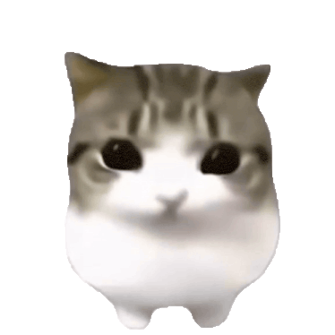

# Dancing Kitty

A lightweight Windows desktop cat that dances to the rhythm of your music.



## Download

Download **Dancing-Kitty-1.0.0-windows-x64.exe** from the [1.0.0 release](https://github.com/Noga-Kurumi/Dancing-Kitty/releases/tag/v1.0.0). It contains the application, ten animation frames, audio models and runtime dependencies. Run it without an installer or administrator privileges. A portable ZIP is also available.

The executable prepares a versioned cache under `%LOCALAPPDATA%\Dancing Kitty\`. Your saved position and size are kept separately in `position.ini`. On first upgrade it preserves the previous CatPulse settings.

## Controls

- **Move:** hold the left mouse button on the cat and drag.
- **Resize:** drag an invisible corner inside the visible bounds of frame 1. The opposite corner stays anchored.
- **Menu:** right-click the cat, or click/right-click its system tray icon. The menu has **Start with Windows** and **Close**.
- The cat stays above ordinary windows and has no taskbar button or Alt+Tab entry. Windows may place the tray icon in its overflow area.
- Position, size and your startup preference are remembered. Startup is opt-in and runs only for the current user.

Menus follow the Windows display language, with English fallback. Included translations: English, Spanish, Portuguese, French, German, Italian, Dutch, Polish, Turkish, Russian, simplified/traditional Chinese, Japanese, Korean, Arabic and Hindi.

## Rhythm and audio

Windows media-session events activate output-audio analysis when a compatible player starts. YAMNet gates music detection (`bMusic`), and BeatNet supplies rhythmic observations. Public Deezer and MusicBrainz/AcousticBrainz lookups can provide a matching recording's BPM. If none is available or the app is offline, the engine estimates tempo locally. No API key or account is required by the app.

A sliding window continuously corrects phase. Catalog BPM stays fixed; local estimates can refine their tempo. Frame 1 aligns with each emitted pulse and the remaining frames fit the next interval. Slow pulses use two animation loops per pulse. When playback or music detection stops, the current loop finishes and the cat holds frame 10.

The engine detects the musical pulse, rather than identifying isolated kick drums. Intros, sparse rhythms and half/double-tempo ambiguity can require learning or cause provisional alignment. It does not promise perfect synchronization on every recording. Players without Windows media sessions do not activate this flow. The captured audio is the output mix, so unrelated sounds can affect the analysis.

Audio analysis stays local. Online lookups send track metadata to the three catalog providers; no audio is uploaded. `--offline` disables catalog requests.

## Build from source

Requires Windows x64, Visual Studio 2022 with **Desktop development with C++** and Windows SDK, CMake 3.20+, and Python 3.10+. Python is only a build tool; the application is native C++17.

```powershell
.\build.ps1
```

The script downloads the pinned ONNX Runtime 1.23.2 development package from NuGet, verifies its SHA-256, compiles Release, runs the six C++ regression tests and creates:

- `dist/Dancing-Kitty-1.0.0-windows-x64.exe` — single-file launcher;
- `dist/Dancing-Kitty-1.0.0-windows-x64.zip` — portable folder;
- `dist/SHA256SUMS.txt` — checksums.

The first run needs Internet only to obtain that build dependency. Existing installations can be supplied with `-OnnxRuntimeRoot`, `-CRuntimeRoot`, `-CMakeExecutable` and `-PythonExecutable`. The two checked-in ONNX models are used directly; PyTorch and TensorFlow are not build or runtime dependencies. See [model attribution](models/README.md) and [third-party notices](THIRD_PARTY_NOTICES.md).

## Project layout

- `src/core`: independent audio and rhythm engine, its public API and regression tests.
- `src/app`: transparent native window, animation clock, drag/resize, tray, localization and settings.
- `src/launcher`: versioned single-executable extraction and launch.
- `assets/frames`: ten original PNG animation frames.
- `models`: the two runtime inference graphs.
- `scripts`: reproducible packaging helpers.

The production app uses event-driven waits, no continuously running UI refresh loop, one-time image decoding and lazy scaled-frame caching. Pausing stops audio capture after a short grace period. The tray uses native shell notifications and is restored after Explorer restarts.

For explicit diagnostics, `--diagnostics PATH.jsonl` records states and animation timing. Normal runs do not write diagnostic logs. The saved size is loaded at every startup, including login startup. Existing placement is constrained only enough to keep the cat reachable after a display configuration change.
